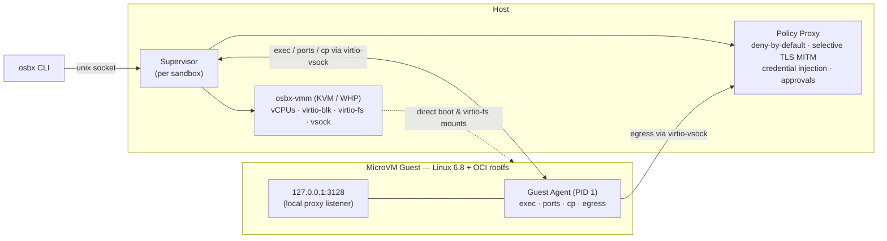

<div align="center">

<picture>
  <source media="(prefers-color-scheme: dark)" srcset="https://raw.githubusercontent.com/lazarnerd/osbx/main/assets/logo-dark.png">
  <source media="(prefers-color-scheme: light)" srcset="https://raw.githubusercontent.com/lazarnerd/osbx/main/assets/logo-light.png">
  
</picture>

### Open-source microVM sandbox runtime for coding agents

Hardware-isolated KVM &amp; WHP microVMs · Zero-NIC egress proxy · Blind credential injection · Kit spec v3

[](https://github.com/lazarnerd/osbx/actions/workflows/ci.yml)
[](https://github.com/lazarnerd/osbx/releases)
[](LICENSE)
[](rust-toolchain.toml)
[](docs/STATUS.md)

[Highlights](#highlights) · [Quick Start](#quick-start) · [Architecture](#architecture) · [Commands](#commands) · [Workspaces](#workspace-modes) · [Status](docs/STATUS.md)

</div>

---

**osbx** is an open-source (Apache-2.0) sandbox runtime for coding agents, modelled on Docker Sandboxes (`sbx`). Each sandbox boots as an isolated microVM driven by osbx's own Rust VMM—with no virtual NIC, deny-by-default egress through a host-side policy proxy, and blind credential injection so secrets never enter the guest.

## Highlights

| | Feature | What it gives you |
| :---: | :--- | :--- |
| **VM** | **MicroVM isolation** | Direct-boot Linux 6.8 microVMs powered by `osbx-vmm` on Linux/KVM and native Windows Hypervisor Platform (WHP)—up to 32 vCPUs and 64 GiB RAM, booting in ~4–5 s. |
| **NET** | **Zero-NIC policy proxy** | No virtual NIC exists inside the guest. All outbound traffic traverses `virtio-vsock` to a host-side deny-by-default proxy with live rule reloads, Layer-7 HTTP rules, and interactive approval. |
| **KEY** | **Blind credential injection** | API keys and OAuth tokens remain on the host. The proxy swaps placeholders for real credentials on the wire—the sandbox never sees them. |
| **KIT** | **Kit spec v3, `osbx-compose.yml` & `sbxenv.yaml`** | Compose OCI or local kits and declarative multi-sandbox environments with tools, firewall rules, credentials, persistent volumes, host mounts, SSH agent forwarding, lifecycle hooks, Docker-in-sandbox, and nested KVM (`kvm@1`). |
| **GIT** | **Safe workspace modes** | Mount your project live (`direct`), hand the agent a private Git clone you can `git fetch` back (`--clone`), or launch an empty environment (`--no-workspace`). |
| **OCI** | **No host Docker required** | Built-in OCI registry client and ext4 builder VM unpack images natively without a Docker daemon (Linux can also read local Docker images). |

## Platform Support

| Host OS | Hypervisor | Status | Notes |
| :--- | :--- | :--- | :--- |
| **Linux** (`x86_64`) | KVM (`/dev/kvm`) | Works end-to-end | Tested on Ubuntu 24.04 and WSL2 · Nested `kvm@1` · Flatpak & source builds |
| **Windows** (`x86_64`) | Windows Hypervisor Platform (WHP) | Works end-to-end | Native Windows 10 2004+ / 11 · Nested `kvm@1` · No WSL or Docker needed at runtime |
| **macOS / `aarch64`** | Hypervisor.framework / KVM | Planned | Portable crates & CLI stub compile; see [`docs/STATUS.md`](docs/STATUS.md) and [`docs/PLAN.md`](docs/PLAN.md) |

## Quick Start

### Linux — Debian / Ubuntu (`.deb`)

Download the latest `osbx_<version>_amd64.deb` from [GitHub Releases](https://github.com/lazarnerd/osbx/releases) and install it with `apt` (installs `/usr/bin/osbx` and bundled guest assets in `/usr/share/osbx/guest` directly on your `PATH`):

```bash
sudo apt install ./osbx_<version>_amd64.deb

osbx vmm probe --run-guest                   # verify host KVM (and nested kvm@1) support
cd ~/my-project
osbx run shell                               # create + start + attach (workspace = cwd)
```

<details>
<summary><strong>Build a local <code>.deb</code> package from source</strong></summary>

```bash
./guest/build-assets.sh --with-osbx          # once, if guest/assets/ is not yet built
./scripts/build-deb.sh --install             # builds dist/deb/osbx_<ver>_amd64.deb and installs it
```

</details>

### Linux — Flatpak

Add the self-hosted OSTree repository (plus Flathub for the `org.freedesktop.Platform` runtime), install `io.github.lazarnerd.osbx`, and symlink the exported launcher to `~/.local/bin/osbx` so you can run `osbx` directly in your terminal:

```bash
# 1. Configure Flatpak remotes and install osbx
flatpak remote-add --user --if-not-exists flathub https://flathub.org/repo/flathub.flatpakrepo
flatpak remote-add --user --if-not-exists --no-gpg-verify osbx https://lazarnerd.github.io/osbx/flatpak-repo
flatpak install --user osbx io.github.lazarnerd.osbx

# 2. Link the exported Flatpak launcher into ~/.local/bin so `osbx` works directly
mkdir -p ~/.local/bin
ln -sf "${XDG_DATA_HOME:-$HOME/.local/share}/flatpak/exports/bin/io.github.lazarnerd.osbx" ~/.local/bin/osbx

# 3. Run osbx (ensure ~/.local/bin is in your PATH)
osbx vmm probe --run-guest                   # verify host KVM (and nested kvm@1) support
cd ~/my-project
osbx run shell                               # create + start + attach (workspace = cwd)

# Upgrade later:
flatpak update --user io.github.lazarnerd.osbx
```

> If `osbx` is not found after linking, add `~/.local/bin` to your `PATH` (for example, `export PATH="$HOME/.local/bin:$PATH"` in `~/.bashrc` or `~/.zshrc`). You can also invoke it directly via `flatpak run io.github.lazarnerd.osbx ...`.

<details>
<summary><strong>Build &amp; upgrade a local Flatpak bundle (or publish via GitHub Pages)</strong></summary>

Build a standalone `.flatpak` bundle and local OSTree repository (`dist/flatpak/`), install it for your user, and add an `osbx` wrapper in `~/.local/bin/osbx`:

```bash
./scripts/build-flatpak.sh --install          # build + install (or upgrade in place)
osbx vmm probe --run-guest                    # or: flatpak run io.github.lazarnerd.osbx ...
```

To **upgrade locally** after pulling new commits, re-run `./scripts/build-flatpak.sh --install`—it exports a new commit to the local OSTree repo and runs `flatpak update --user`, preserving sandboxes in `~/.var/app/io.github.lazarnerd.osbx/data/osbx`.

To **publish upgrades on any machine**, enable GitHub Pages (**Source: GitHub Actions**). The [`flatpak`](.github/workflows/flatpak.yml) workflow triggers on version tags (`v*`, e.g. `v0.1.0`) or manual dispatch, publishing the OSTree repo at `https://lazarnerd.github.io/osbx/flatpak-repo` and attaching `osbx-<ver>-x86_64.flatpak` to the GitHub Release.

</details>

### Linux — Build from source

> **Requirements:** Linux with usable `/dev/kvm` (user in the `kvm` group), Rust 1.90+, `fakeroot`, `e2fsprogs` (`mke2fs`), `git`, and Docker (only to read local Docker images). Building guest assets additionally requires `apt-get`, `dpkg-deb`, `cpio`, `zstd`, `kmod`, and the `x86_64-unknown-linux-musl` Rust target.

```bash
./guest/build-assets.sh --with-osbx          # build guest kernel, initramfs, agent (guest/assets/)
cargo build --release -p osbx-cli
export OSBX_ASSETS=$PWD/guest/assets PATH=$PWD/target/release:$PATH

osbx vmm probe --run-guest                   # verify host KVM (and nested kvm@1) support
cd ~/my-project
osbx run shell                               # create + start + attach (workspace = cwd)
```

### Windows — Native WHP

> **Requirements:** Windows 10 2004+ or 11 with **Windows Hypervisor Platform** enabled (`Enable-WindowsOptionalFeature -Online -FeatureName HypervisorPlatform` in an elevated PowerShell, then reboot) and Rust (MSVC). Docker is not needed—osbx pulls and unpacks OCI images itself. Guest assets are built once on Linux or WSL (`guest/build-assets.sh --with-osbx`).

```powershell
scripts\install-osbx.ps1          # builds osbx.exe and installs binary + guest assets to %LOCALAPPDATA%\osbx
osbx vmm probe --run-guest        # verify WHP and nested virtualization (kvm@1)
cd C:\src\my-project
osbx run shell                    # project appears inside the sandbox at /c/src/my-project
```

## Architecture



> [!NOTE]
> **There is no virtual NIC.** The guest's only path to the outside network is `127.0.0.1:3128` → guest agent → `virtio-vsock` → host policy proxy.

## Workspace Modes

| Mode | Flag | Behavior |
| :--- | :--- | :--- |
| **Direct** | *(default)* | Shares the directory read-write at the same absolute path, live in both directions. |
| **Clone** | `--clone` | Gives the agent a private clone at that path, mounts the original read-only at `/run/sandbox/source`, and adds a `sandbox-<name>` Git remote to your repo so you can `git fetch` the agent's commits. |
| **None** | `--no-workspace` | Starts the sandbox without mounting a host workspace. |

Sandbox state lives in `$OSBX_HOME` (default `~/.local/share/osbx` on Linux, `%LOCALAPPDATA%\osbx` on Windows).

## Commands

### Sandbox Lifecycle & Interaction

| Command | Description |
| :--- | :--- |
| `osbx create [FLAGS] [AGENT]` | Create a sandbox (root filesystem built from an OCI image and cached). Supports `--name`, `--image`, `-w DIR \| --no-workspace`, `--clone`, `--kit K`, `--kit-arg [K.]A=V`, `--kvm`, `--docker`, `--template T`, `-e K=V`, `--mem MiB`, `--cpus N`, `--disk 40g`. |
| `osbx run [CREATE FLAGS] [AGENT] [-- CMD...]` | Create if needed, start if needed, and attach to the agent (interactive TTY). |
| `osbx start \| stop \| rm [-f] NAME` · `osbx ls` | Manage sandbox lifecycle; the root disk persists across stop and start. |
| `osbx exec [-i] [-t] [-u USER] [-w DIR] [-e K=V] NAME -- CMD` | Run a command inside a running sandbox (exit status and stderr pass through). |
| `osbx cp SRC DST` | Copy files between host and sandbox (prefix guest side with `NAME:/abs/path`). |
| `osbx ports NAME [--publish [IP:]HOST:GUEST]` | Forward a guest port as raw TCP (HTTP, WebSockets, VNC, SSH), bound to `127.0.0.1` by default. |
| `osbx logs NAME` | View the guest serial console output. |
| `osbx save NAME TEMPLATE` · `osbx templates` | Snapshot a stopped sandbox into a reusable template (`osbx create --template T`). |

### Network Policy & Credentials

| Command | Description |
| :--- | :--- |
| `osbx policy ls \| init PRESET \| allow DEST \| deny DEST \| rm DEST [--sandbox N]` | Inspect or update network policy rules (running sandboxes reload live). |
| `osbx policy pending NAME` · `osbx policy approve NAME DEST [--all-sandboxes]` | Inspect destinations refused by default-deny and approve them on the fly. |
| `osbx secret set SERVICE [--sandbox N] [--command CMD \| --ref REF]` | Store host-side credentials injected by the proxy (reads value from stdin by default). |
| `osbx secret ls \| rm \| bind \| unbind \| bindings` | Manage stored secrets and `credentials.yaml` domain bindings. |

### Environments, Validation & VMM

| Command | Description |
| :--- | :--- |
| `osbx env run [FILE] [--env-arg k=v] [-d]` | Launch the full sandbox environment defined in an `sbxenv.yaml`. |
| `osbx compose [-f FILE] [--profile P] up \| run \| down \| ps \| plan \| config \| check` | Manage multi-sandbox environments defined in an `osbx-compose.yml` (see [`docs/COMPOSE_SPEC.md`](docs/COMPOSE_SPEC.md)). |
| `osbx kit validate FILE...` · `osbx env check\|config [FILE]` · `osbx compose check\|config` · `osbx policy check ...` | Offline validation and canonical IR inspection for Kit v3 descriptors, `sbxenv.yaml`, `osbx-compose.yml`, and network policies. |
| `osbx vmm probe [--run-guest] [--require-nested]` | Check host hypervisor readiness and nested KVM (`kvm@1`) capability. |
| `osbx vmm boot --kernel K --initrd I` | Boot a kernel and initramfs directly with the osbx VMM. |

## Project Layout

<details>
<summary><strong>Workspace crates &amp; repository directories</strong></summary>

### Crates (`crates/`)

| Crate | Role |
| :--- | :--- |
| `osbx-cli` | The `osbx` CLI binary |
| `osbx-sandbox` | Sandbox supervisor coordinating VM, guest agent, and policy proxy |
| `osbx-vmm` | KVM &amp; WHP virtual machine monitor, virtio-MMIO devices, FUSE server, and hypervisor probe |
| `osbx-proxy` | Host-side egress policy proxy (deny-by-default, selective TLS MITM, credential injection) |
| `osbx-policy` | Network policy rules, presets, and evaluation precedence |
| `osbx-secrets` | Credential stores, sources, OAuth handling, and injection bindings |
| `osbx-kit` | Kit spec v3 descriptors, validation, composition, and capability selection |
| `osbx-spec` | Canonical internal verbose sandbox specification IR shared by `osbx-env` and `osbx-compose` |
| `osbx-compose` | Docker Compose-style `osbx-compose.yml` parser compiling to `osbx-spec` |
| `osbx-env` | `sbxenv.yaml` environment specification parser compiling to `osbx-spec` |
| `osbx-image` | OCI registry client and ext4 root filesystem builder |
| `osbx-agent` · `osbx-proto` | In-guest PID 1 agent and host/guest vsock wire protocol |

### Directories

| Path | Contents |
| :--- | :--- |
| `crates/` | Rust workspace (see above) |
| `guest/` | Guest init and `build-assets.sh` (builds kernel, initramfs, and agent into git-ignored `guest/assets/`) |
| `third_party/vm-memory/` | Patched `vm-memory` (see [`OSBX-PATCH.md`](third_party/vm-memory/OSBX-PATCH.md)) |
| `scripts/` | Install and packaging scripts (`install-osbx.ps1`, `build-deb.sh`, `build-flatpak.sh`) |
| `packaging/` | Self-hosted Flatpak AppStream metainfo |
| `assets/` | Project logo and icon marks (`logo-dark`, `logo-light`, `icon` in SVG and retina PNG) |
| `docs/` | [`ARCHITECTURE.md`](docs/ARCHITECTURE.md), [`COMPOSE_SPEC.md`](docs/COMPOSE_SPEC.md), [`STATUS.md`](docs/STATUS.md), [`PLAN.md`](docs/PLAN.md), [`PROVENANCE.md`](docs/PROVENANCE.md) |
| `dev/` | Contributor dev environment (Docker `sbx` sandbox, skills); not part of the runtime |

</details>

## Testing

```bash
cargo test --workspace
```

The workspace includes **138 tests** (unit, integration, and end-to-end microVM runs). Tests requiring `/dev/kvm`, guest assets, local Docker images, or the upstream kit spec checkout automatically skip with a note when unavailable. Set `OSBX_SPEC_EXAMPLES=<sandbox-kit-spec>/examples` to validate against all upstream example kits.

## Documentation

- [`docs/ARCHITECTURE.md`](docs/ARCHITECTURE.md) — VMM, proxy, vsock protocol, and sandbox design
- [`docs/COMPOSE_SPEC.md`](docs/COMPOSE_SPEC.md) — `osbx-compose.yml` specification and `osbx compose` CLI reference
- [`docs/STATUS.md`](docs/STATUS.md) — Detailed breakdown of what works today and known gaps
- [`docs/PLAN.md`](docs/PLAN.md) — Project roadmap
- [`guest/README.md`](guest/README.md) — Building guest assets and kernel boot modes
- [`docs/PROVENANCE.md`](docs/PROVENANCE.md) — Provenance rules

## License

Licensed under the [Apache License, Version 2.0](LICENSE).
