# osbx architecture

From the outside in: the system and what it talks to, the crates, the host runtime, the main
flows (create, start, exec, egress), then the VMM and the guest at the bottom.

## 1. System context

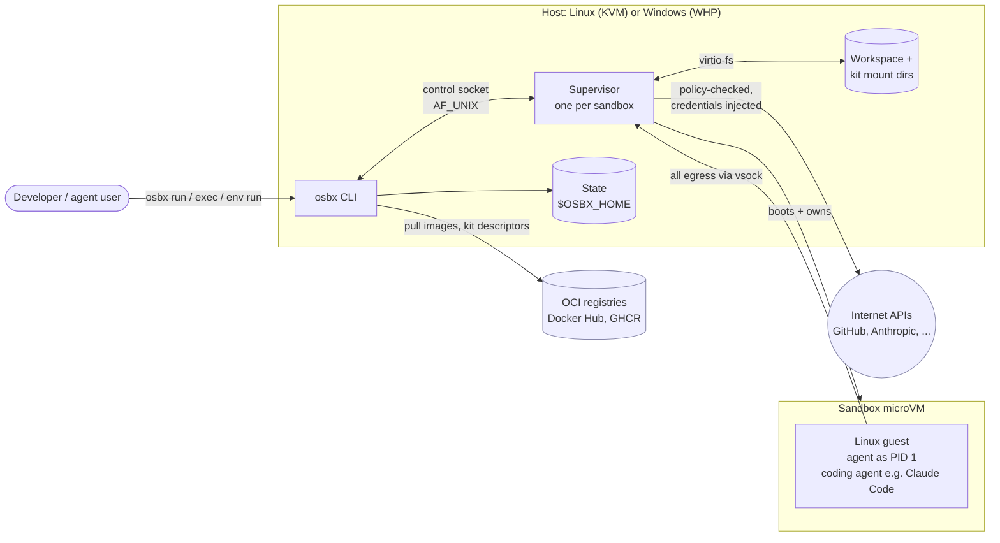

## 2. Crates

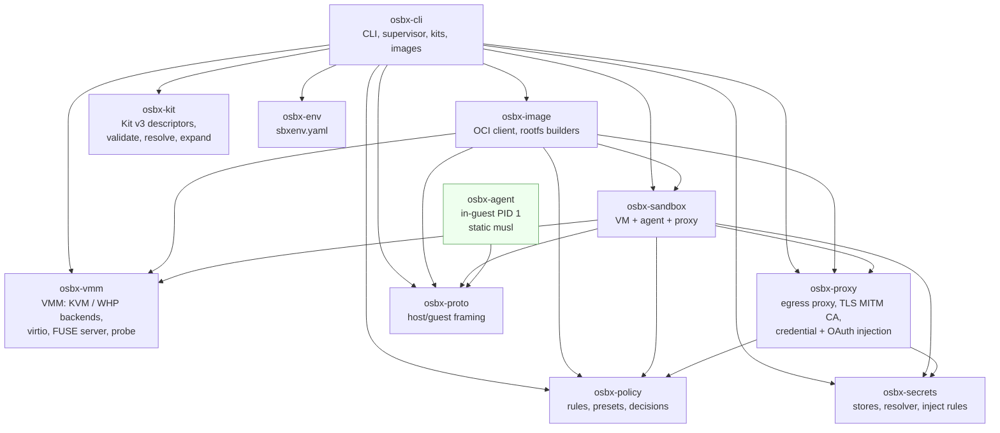

## 3. Host runtime

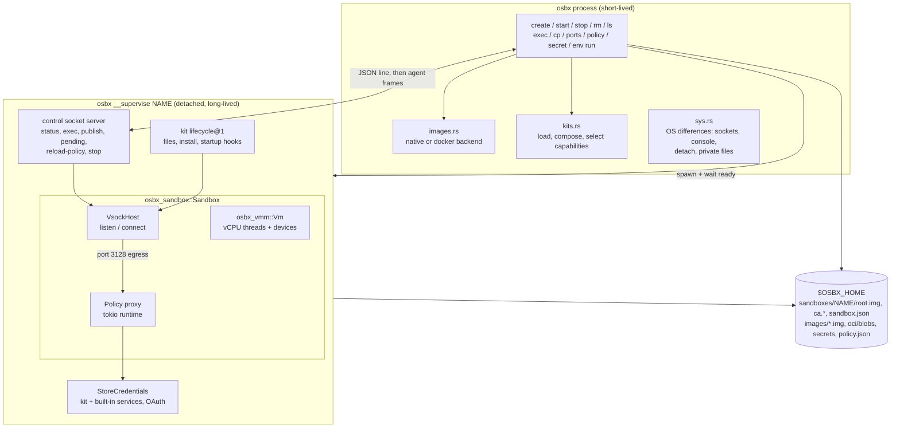

## 4. Sandbox lifecycle

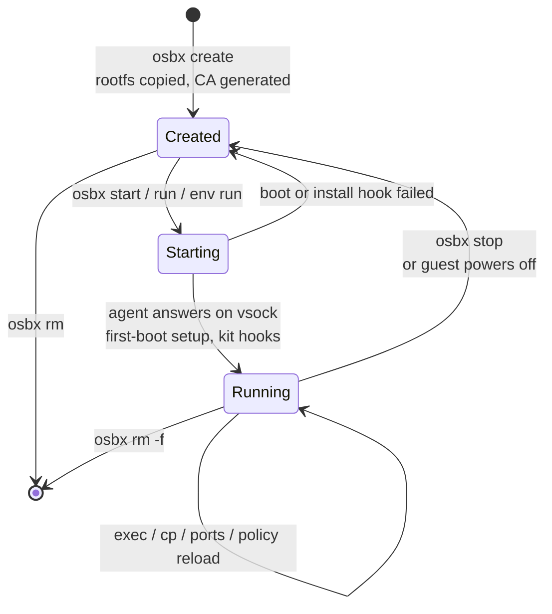

## 5. Create and start

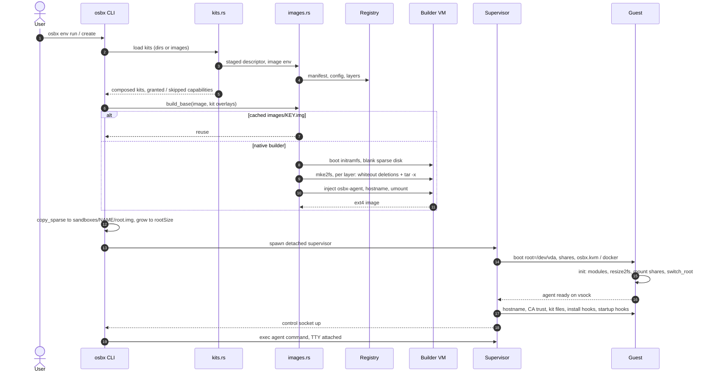

## 6. Egress, policy and credentials

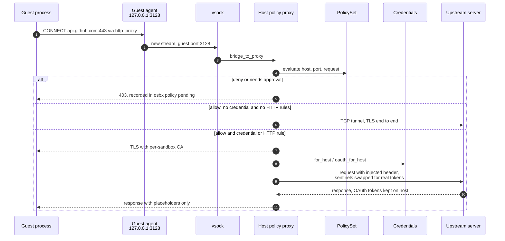

## 7. Image build pipeline

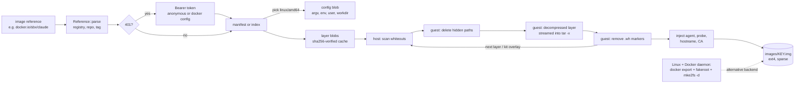

## 8. Kit composition

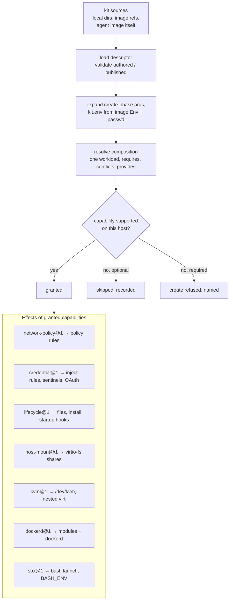

## 9. VMM layers

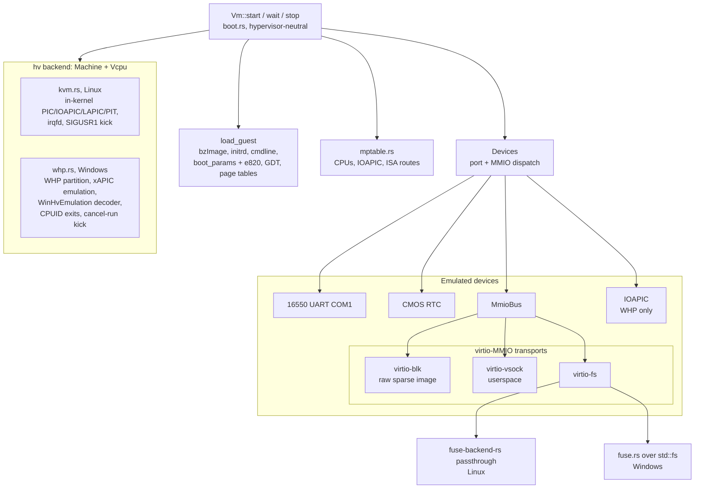

## 10. Guest physical memory map

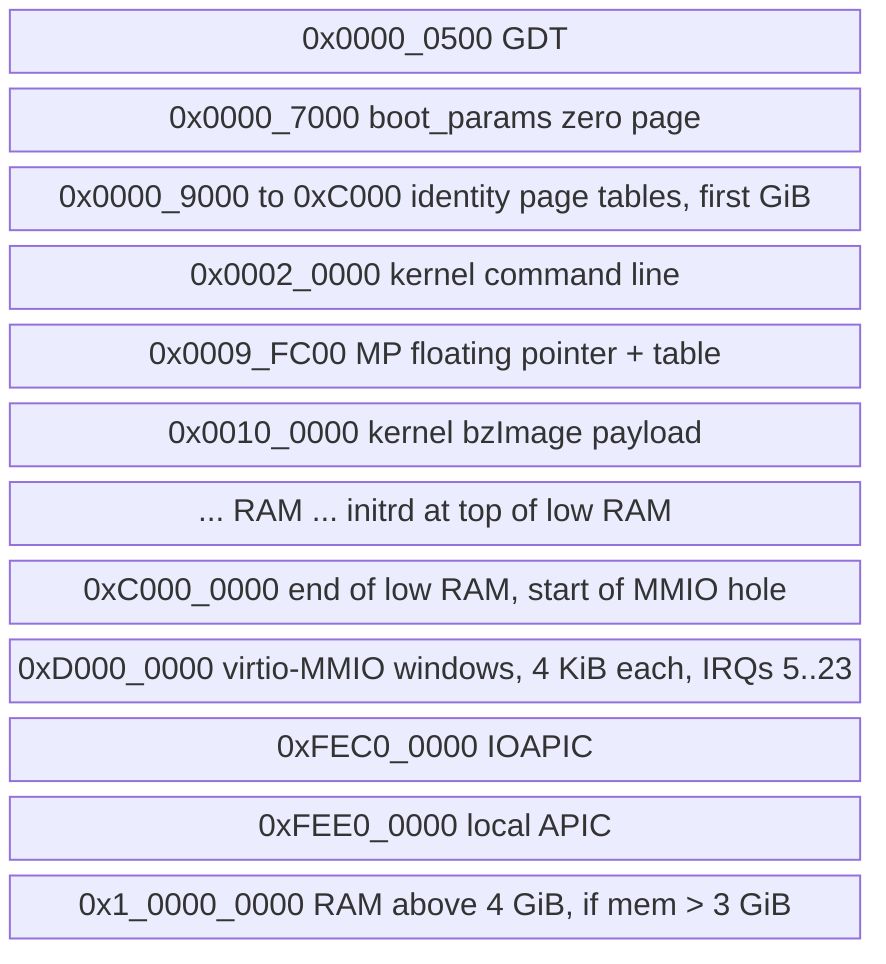

## 11. One vCPU exit, both backends

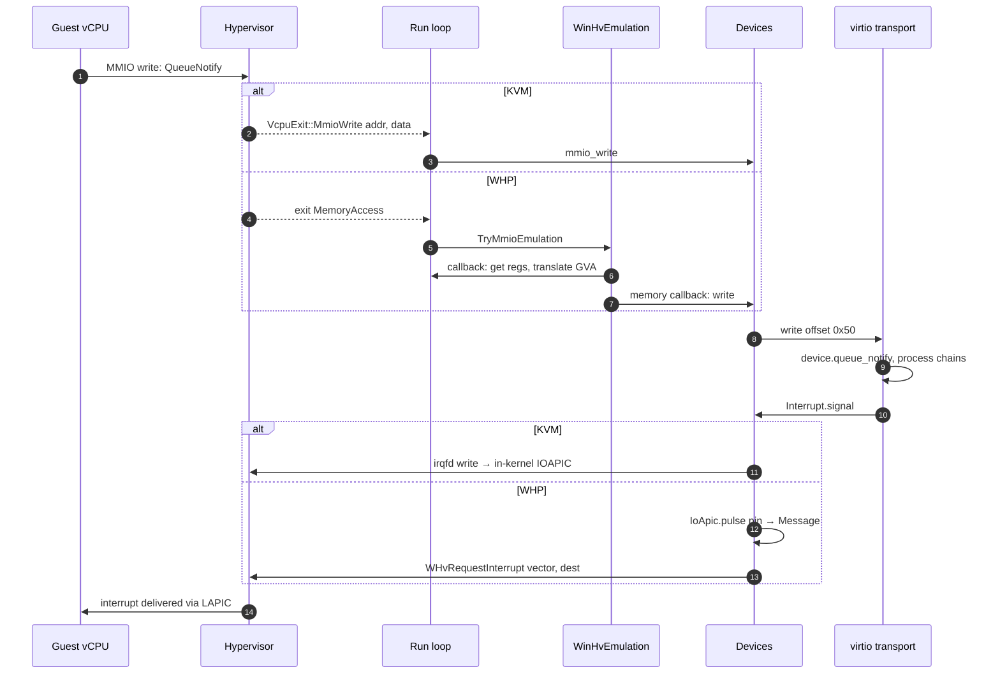

## 12. Interrupt routing

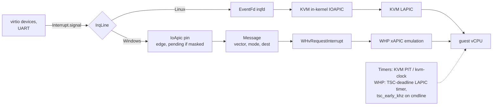

## 13. virtio-vsock and agent protocol

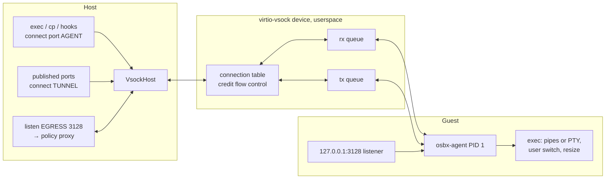

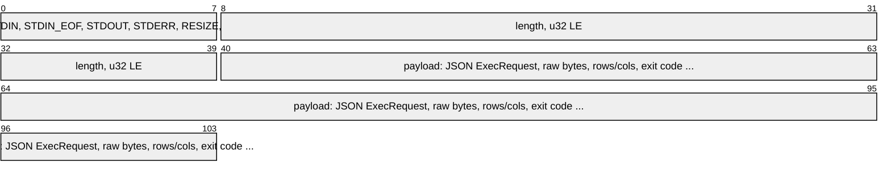

## 14. virtio-fs on Windows

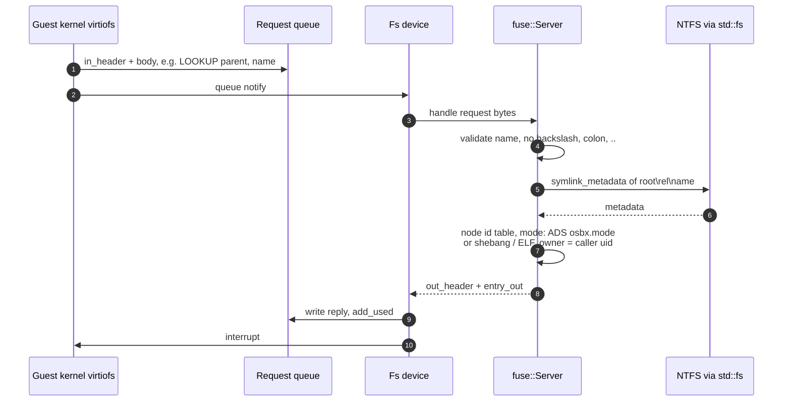

## 15. Guest boot

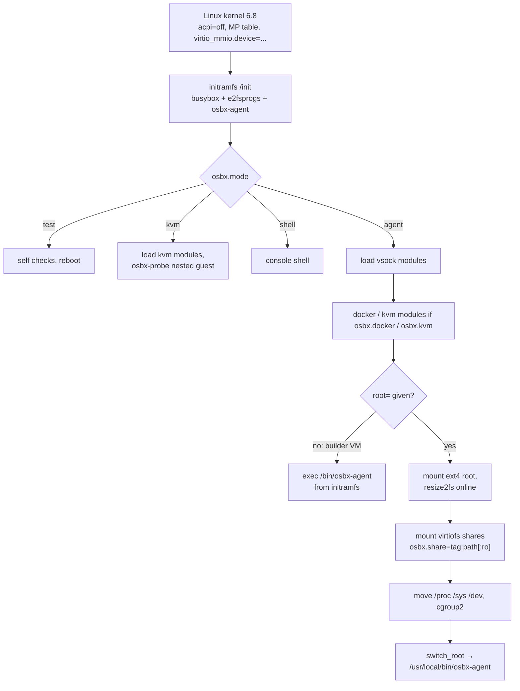

## 16. On-disk state

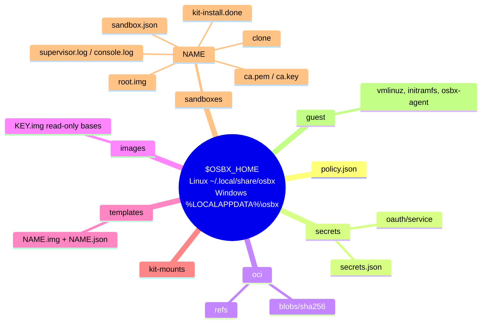
