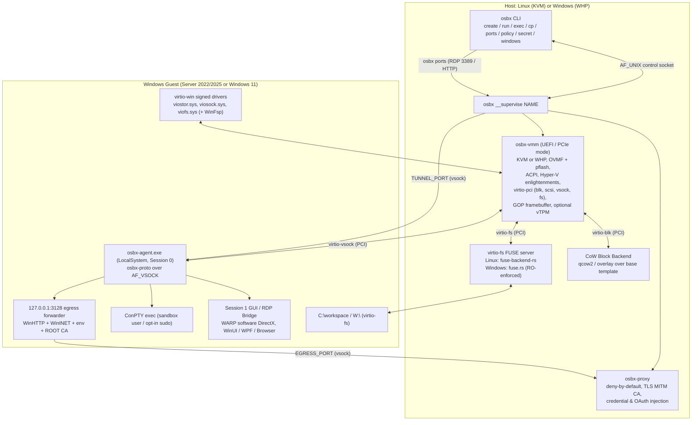

# Windows-Guest Sandboxes in `osbx`: Evaluation & Architecture Decision

Status: **Evaluation complete; KVM UEFI/OVMF boot spike verified (`crates/osbx-vmm/src/uefi.rs`).**

## 1. Executive Summary

`osbx` already runs **Linux-guest microVMs** on both Linux (KVM) and Windows (WHP) hosts. This
document evaluates running **Windows-guest sandboxes** inside `osbx` so coding agents can build,
run, and test native Windows software (MSVC, MSBuild, .NET, Rust MSVC, WinUI/WPF, Windows browsers)
while preserving `osbx`'s core security guarantees: VM isolation, deny-by-default egress through the
host policy proxy, host-side credential/OAuth injection, and host-enforced read-only workspace
mounts.

### Key Architectural Decisions

| Dimension | Decision |
|---|---|
| **Host OS matrix** | **Linux (KVM) and Windows (WHP)** as Tier 1; macOS (ARM64) deferred / best-effort later. |
| **Target guest OSes** | **Windows Server 2022/2025** (Core for lean headless, Desktop Experience for GUI) and **Windows 11** (Pro/Enterprise/IoT LTSC, with UEFI + optional vTPM 2.0 / Secure Boot). |
| **Guest workloads** | All three tiers: minimal headless CLI/build, optional software-rendered GUI/RDP, and interactive desktop / browser / WinUI / WPF testing (hardware 3D GPU evaluated for Phase 2). |
| **VMM strategy** | **Zero external VMM binaries** (no QEMU runtime dependency). Extend `osbx-vmm` directly with UEFI, PCIe/`virtio-pci`, ACPI, and Hyper-V enlightenments, reusing permissive (Apache-2.0/MIT/BSD) Rust crates (`rust-vmm`, Cloud Hypervisor, OpenVMM) where cleanly modular. |
| **Guest assets** | Fetch/cache signed open-source guest firmware & drivers at setup time: **EDK2 OVMF** (BSD-2-Clause-Patent) and **Red Hat `virtio-win`** (BSD-3-Clause, Microsoft-signed). Flag GPLv3 caveats (WinFsp) explicitly. |
| **Network isolation** | **v1: Strict no-NIC, vsock-only proxy** (`osbx-agent.exe` on `127.0.0.1:3128` -> `viosock` -> host `osbx-proxy`, configuring WinHTTP + WinINET + env vars + Windows `ROOT` cert store). Evaluate isolated host-terminated `virtio-net` + userspace stack (`smoltcp`) if Windows NLA / proxy-unaware tools require it. |
| **Display & GUI** | **v1: UEFI GOP / simple linear framebuffer** for boot/install + **RDP over vsock tunnel (`osbx ports`) with Windows WARP software DirectX** for desktop/WinUI/browser testing. **Phase 2:** evaluate `virtio-gpu` (`viogpudo`/`viogpu3d`), VFIO, and GPU-PV. |
| **Workspace sharing** | **Primary:** Reuse `osbx-vmm`'s existing host `virtio-fs` FUSE servers over `virtio-pci` (`viofs.sys` + WinFsp) mounted at a clean Windows path (`C:\workspace` or `W:\`); recommend `--clone` for heavy MSVC/Cargo builds. **Fallback:** evaluate host-side SMBv3 over vsock. |
| **Base images & storage** | Support **both** automated unattended ISO builds (`autounattend.xml` + `virtio-win` + `osbx-agent.exe`, user-supplied or official MS Eval ISOs) **and** direct VHDX/raw import, cached as templates. **CoW disk overlays required in v1**; cold boot (~20–40s) acceptable in v1 with VM memory snapshots evaluated for Phase 2. |
| **In-guest privilege & session model** | `osbx-agent.exe` runs as a **LocalSystem Windows Service (Session 0)**, spawning agent commands as a dedicated sandbox user with non-hanging opt-in Admin elevation / Windows `sudo` (`osbx exec -u Administrator`) and a **Session 0 -> Session 1** bridge for interactive GUI/RDP apps. |
| **Nested virtualization** | **Phase 2 optional capability** (WSL2, Windows Containers, nested Hyper-V inside Windows guests); not a v1 blocker. |
| **CLI, Kits & `sbxenv.yaml`** | **First-class unified `osbx` CLI & runtime** (`create`/`run`/`exec`/`cp`/`ports`/`policy`/`secret`/`save`/`templates`, same `osbx-proto` over vsock + ConPTY). Templates + CLI flags first; Windows Kit v3 / `sbxenv.yaml` extensions (PowerShell hooks, Windows mounts) designed cleanly alongside. |

### Spike Outcome (Verified on Linux/KVM)

To validate the riskiest assumption of extending `osbx-vmm` directly—transitioning from Linux 64-bit
direct boot (`acpi=off pci=off`) to x86 real-mode UEFI firmware boot—we built a minimal UEFI spike
in [`crates/osbx-vmm/src/uefi.rs`](../crates/osbx-vmm/src/uefi.rs) (~470 LOC) and ran it against
Ubuntu's stock EDK2 OVMF images on `/dev/kvm`:

- **Booted `/usr/share/ovmf/OVMF.fd` (4 MiB, 2 vCPUs, 512 MiB RAM)** from the x86 reset vector
  (`0xFFFF_FFF0`) through SEC -> PEI -> DXE -> BDS -> **UEFI Interactive Shell v2.2** on COM1 in
  **~3.5 seconds** (8.7 s total including the 5 s `startup.nsh` countdown), executed `ver`, and
  powered off cleanly via **ACPI S5** (`reset -s` -> `PM1a_CNT` `SLP_EN` -> `ExitReason::GuestReset`).
- **Booted split `/usr/share/OVMF/OVMF_CODE_4M.fd` + `OVMF_VARS_4M.fd` (2 vCPUs, 4 GiB RAM)**
  spanning the 32-bit MMIO hole (`0xC000_0000`) and verified `memmap` reports memory above 4 GiB via
  CMOS `0x5b..=0x5d` and `fw_cfg` `etc/e820`.
- Verified via `cargo test -p osbx-vmm --test uefi` and `cargo clippy -p osbx-vmm --all-targets -- -D warnings`.

---

## 2. Gap Analysis: Current `osbx-vmm` vs. Windows Guest Requirements

`osbx-vmm` today is a compact, clean VMM (~2,500 LOC) designed specifically for Linux direct boot:

| Subsystem | Today in `osbx-vmm` (Linux guests) | Required for Windows Server 2022/2025 & Win 11 |
|---|---|---|
| **Boot protocol** | Direct 64-bit Linux `bzImage` (`boot.rs`), `acpi=off pci=off`, MP table at `0x9FC00`. | **UEFI firmware** (OVMF / `mu_msvm`) starting at x86 16-bit reset vector `0xFFFF_FFF0` in top-of-4 GiB flash, with persistent NVRAM (`OVMF_VARS`, CFI pflash). |
| **Bus & discovery** | `MmioBus` (`bus.rs`): 17 `virtio-mmio` slots at `0xD000_0000`, announced via kernel cmdline. | **PCI / PCIe root complex** (`0xCF8`/`0xCFC` + ECAM MMIO) and **`virtio-pci`** transport. Windows `virtio-win` drivers **only bind to `virtio-pci`**, not `virtio-mmio`. |
| **Interrupts** | Edge-triggered IOAPIC GSIs (`irq.rs`, `ioapic.rs` on WHP, in-kernel irqchip on KVM). | **MSI / MSI-X** (required for high-throughput `virtio-pci` queues and Windows PnP multi-queue drivers) + ACPI MADT / PCI IRQ routing (`_PRT`). |
| **ACPI** | None (`acpi=off`). | Full **ACPI tables** (RSDP, XSDT, FADT, MADT, MCFG, DSDT, optional HPET/TPM2) + ACPI PM timer (`3.579545 MHz`), `PM1a_CNT` S5 shutdown, and SCI/power button. |
| **Timers & clocks** | KVM `kvm-clock` + PIT; WHP TSC-deadline LAPIC timer + `tsc_early_khz` + read-only CMOS UTC. | **ACPI PM Timer**, **HPET** (or Hyper-V Reference Time Counter MSR `0x40000020`), **Hyper-V SynIC/STIMER**, and writable/alarm-safe CMOS RTC. |
| **Hypervisor enlightenments** | Linux KVM CPUID leaves only. | **Hyper-V TLFS enlightenments** (`hv_relaxed`, `hv_vapic`, `hv_vpindex`, `hv_time`, `hv_synic`, `hv_stimer`, `hv_runtime`, `hv_reset`, `hv_tlbflush`) — critical for Windows performance & avoiding watchdog BSODs on KVM. |
| **Storage** | `virtio-blk` over `virtio-mmio` backed by raw sparse files (`copy_sparse` on create). | `virtio-blk` (or `virtio-scsi`) over **`virtio-pci`**, **CoW disk overlay** (qcow2 / block-diff / reflink), plus virtual CD-ROM/ISO attachment (`virtio-scsi` CD or AHCI/ATAPI) for unattended Windows ISO installation. |
| **Console / Display** | 16550 UART COM1 (`0x3F8`) only. | COM1 (`0x3F8`, headless/EMS/OVMF) + **UEFI GOP / simple linear framebuffer** (Bochs VGA / `virtio-gpu` 2D) for boot/install + **RDP over vsock** for desktop/GUI. |
| **Security / Win11** | None. | Optional **vTPM 2.0** (CRB MMIO at `0xFED4_0000`) + **UEFI Secure Boot** (`OVMF_CODE_4M.secboot.fd` + SMM or non-SMM variable lock) for compliant Windows 11 installs. |
| **Host backend parity** | KVM (`kvm.rs`) + WHP (`whp.rs`). | Must work on **both KVM and WHP** (WHP needs real-mode/unrestricted-guest reset vector, MMIO ECAM decode via `WinHvEmulation`, MSI injection via `WHvRequestInterrupt`, and Hyper-V enlightenment passthrough/emulation). |

### Concrete Findings from the KVM OVMF Spike

Building [`crates/osbx-vmm/src/uefi.rs`](../crates/osbx-vmm/src/uefi.rs) immediately exposed five
real hardware subtleties that are easy to miss on paper:

1. **KVM TSS / Identity Map collision with 4 MiB OVMF flash:** `kvm.rs` places KVM's TSS at
   `0xFFFB_D000` and identity map at `0xFFFB_C000`, which falls *inside* the 4 MiB firmware window
   (`0xFFC0_0000..0x1_0000_0000`). Moving them to `0xFEB0_0000` / `0xFEB0_4000` (below IOAPIC
   `0xFEC0_0000`) resolves the overlap cleanly.
2. **PCI Command register (`0x04..0x06`) vs. BAR probing (`0x10..0x28`):** OVMF's `PciBusDxe` probes
   every device's BARs by writing `0xFFFF_FFFF` and enables I/O decoding via PCI Command (`0x04`).
   If Command writes are ignored, `SioBusDxe` never enables COM1 (`0x3F8`); if unused BARs echo back
   `0xFFFF_FFFF`, `PciBusDxe` fails resource allocation.
3. **i8042 keyboard port (`0x64`) must return `0xFF` when absent:** Returning `0x00` (as Linux
   `devices.rs` does with `i8042.dumbkbd`) causes OVMF's `Ps2KeyboardDxe` to poll port `0x64` over
   220,000 times (~5–10 seconds of wasted boot time) waiting for a keyboard self-test ACK. Returning
   `0xFF` makes `Ps2KeyboardDxe` bail out in < 1 ms.
4. **ACPI PM Timer (`PM_BASE + 0x08`) is mandatory for OVMF `TimerLib`:** OVMF programs PIIX4 PMBA
   (`00:01.3` reg `0x40`) to `0xB000` and reads `0xB008` thousands of times for delays and the boot
   countdown. A monotonic `3.579545 MHz` counter is required.
5. **vTPM MMIO probe (`0xFED4_0000`) happens unconditionally:** Even on non-SecureBoot `OVMF.fd`,
   OVMF probes the TPM CRB/TIS MMIO window at `0xFED4_0000` during DXE; returning `0xFF` cleanly
   signals "no TPM present", and this is the exact address where a Phase-1/2 vTPM 2.0 device plugs in.

---

## 3. VMM Architecture Options (Build vs. Borrow)

Because **zero external VMM binaries** is a core requirement, QEMU is excluded as a runtime
dependency (it remains valuable only as a differential-testing oracle during bring-up). Four options
were evaluated:

| Option | Description | Pros | Cons / Risks | Verdict |
|---|---|---|---|---|
| **A. Extend `osbx-vmm` + selective permissive Rust crates** | Keep `osbx-vmm`'s KVM + WHP `Machine`/`Vcpu` core and `virtio` device implementations (`blk`, `vsock`, `fs`); add a **`virtio-pci` transport**, **PCIe/ECAM + ACPI + CFI pflash + Hyper-V enlightenments**, reusing Apache-2.0/MIT crates (`acpi_tables`, `pci`, `virtio-queue`, `vm-memory`, select Cloud Hypervisor / OpenVMM crates) where clean. | Single binary, zero external VMMs; reuses 100% of `osbx-vmm`'s KVM/WHP backends, `virtio-vsock`, and Linux+Windows `virtio-fs` FUSE servers; preserves `osbx`'s tight security/auditability (`unsafe_code = "deny"`). | Non-trivial VMM engineering (~4–8k LOC across PCIe, MSI-X, ACPI, pflash, Hyper-V enlightenments, GOP framebuffer, WHP real-mode/enlightenments). | **Recommended** |
| **B. Pure hand-rolled `osbx-vmm`** | Same as A, but hand-write PCIe, ACPI table builders, pflash, and Hyper-V enlightenments inside `osbx-vmm` with only existing `rust-vmm` deps (`vm-memory`, `virtio-queue`). | Minimal dependency tree; full control over KVM/WHP parity and binary size; matches `osbx-vmm`'s existing style. | Higher initial engineering time for ACPI AML/DSDT, PCIe ECAM, and Hyper-V SynIC/STIMER edge cases; higher risk of subtle Windows BSODs. | **Viable fallback** (actually overlaps A: hand-roll small pieces like pflash/CMOS/GOP, borrow/adapt proven ACPI/PCI/TLFS logic) |
| **C. Embed Microsoft OpenVMM (`microsoft/openvmm`, MIT) as backend** | Pull OpenVMM's Rust VMM crates directly into `osbx` for Windows guests. | Battle-tested Windows guest support on both KVM and WHP; already has UEFI (`mu_msvm`), ACPI, VMBus, virtio-pci, vTPM, and Hyper-V enlightenments; MIT licensed. | Massive monorepo (~hundreds of internal crates, not published cleanly to crates.io); Windows guests in OpenVMM lean heavily on VMBus rather than `osbx`'s custom `virtio-vsock` / `virtio-fs` FUSE stack; heavy build times and coupling. | **Reference & selective crate inspiration**, not wholesale embedding |
| **D. External QEMU / Cloud Hypervisor binary** | Orchestrate `qemu-system-x86_64` or `cloud-hypervisor` as a child process. | Fastest path to booting Windows 11 + GUI + vTPM today. | Violates zero-external-VMM-binary constraint; Cloud Hypervisor is Linux-only (no WHP backend) and has no VGA/GOP/framebuffer; QEMU adds ~100+ MB external runtime, GPLv2 packaging friction, and huge attack surface. | **Rejected for runtime** (use QEMU only as an offline bring-up/golden-reference oracle) |

### Firmware Choice: Stock EDK2 OVMF vs. `OvmfPkg/CloudHv` vs. `mu_msvm`

- **Stock EDK2 OVMF (`OVMF_CODE_4M.fd` + `OVMF_VARS_4M.fd`):** Best v1 choice. Widely packaged,
  prebuilt signed/reproducible binaries exist on Linux distros and upstream CI, supports both Q35
  (PCIe ECAM) and i440FX, supports Secure Boot (`OVMF_CODE_4M.secboot.fd`), has built-in `VirtioBlkDxe`,
  `VirtioScsiDxe`, GOP framebuffer, and Serial Console, and boots identically on **both KVM and WHP**
  (as verified on KVM in our spike).
- **`OvmfPkg/CloudHv` (`CLOUDHV.fd`):** Cleaner PVH boot (skips 16-bit real mode and legacy CMOS),
  which is very appealing for WHP too—**however**, it strips out VGA/GOP framebuffer and relies on
  Cloud Hypervisor's exact PVH + ACPI handoff (`CloudHvAcpiPlatformDxe`) and requires us to build
  and distribute a custom EDK2 image. Worth keeping as a Phase-2 optimization for headless Server
  Core fast-boot, while using standard OVMF (Q35/PCIe or i440FX+ECAM) for general Windows 11 +
  Desktop + Server compatibility.

---

## 4. Target System Architecture

---

## 5. Detailed Subsystem Design

### 5.1 VMM Extensions (`osbx-vmm`)

To take the KVM OVMF spike from "UEFI Shell" to "boots Windows Server 2022/2025 & Windows 11 on
both KVM and WHP", `osbx-vmm` needs the following modular additions (while leaving the existing
fast Linux direct-boot path untouched):

1. **PCIe Root Complex & `virtio-pci` Transport (`crates/osbx-vmm/src/pci/`):**
   - Implement PCIe ECAM MMIO window (e.g., `0xB000_0000..0xC000_0000`, 256 MiB for Bus 0..255, or
     16 MiB for Bus 0..15) alongside legacy `0xCF8`/`0xCFC` config access (Q35/MCH `8086:29c0` +
     ICH9 LPC `8086:2918` or i440FX + ECAM).
   - Implement **`VirtioPciTransport`** wrapping the existing `VirtioDevice` trait (`Block`,
     `Vsock`, `Fs`, plus a read-only `VirtioScsi` / ATAPI CD-ROM for ISO install) using modern
     virtio 1.0 PCI capabilities (`COMMON_CFG`, `NOTIFY_CFG`, `ISR_CFG`, `DEVICE_CFG`, `PCI_CFG`)
     in a 64-bit BAR + **MSI-X** capability table!
   - **Why `virtio-pci` is essential:** Every `osbx-vmm` device (`blk.rs`, `vsock.rs`, `fs.rs`,
     `fs_windows.rs`) already implements `VirtioDevice` cleanly separated from `MmioTransport`.
     Adding `PciTransport` lets Windows's signed `virtio-win` drivers (`viostor.sys`, `viosock.sys`,
     `viofs.sys`) talk directly to `osbx-vmm`'s existing device backends without rewriting device
     logic.
2. **MSI / MSI-X Interrupt Routing (KVM & WHP):**
   - **KVM:** Allocate KVM GSI routing entries (`KVM_SET_GSI_ROUTING`) mapping MSI-X table entries
     to `EventFd`s (`KVM_IRQFD`), reusing `IrqLine`.
   - **WHP:** Decode MSI-X address/data into `WHV_INTERRUPT_CONTROL` and call `WHvRequestInterrupt`
     directly (WHP already emulates xAPIC/MSI delivery!).
3. **ACPI Tables & Power Management (`crates/osbx-vmm/src/acpi.rs`):**
   - Generate and expose via `fw_cfg` (`etc/acpi/tables`, `etc/acpi/rsdp`, `etc/table-loader`)—or
     write directly for PVH—the minimum Windows-compliant ACPI table set:
     - **RSDP / XSDT**
     - **FADT** (ACPI 5.0+, `PM_TMR_BLK`, `PM1a_CNT_BLK`, `RESET_REG`, `HW_REDUCED` = 0 for full
       Windows compatibility)
     - **MADT** (Local APICs for all vCPUs, IOAPIC at `0xFEC0_0000`, ISO overrides for IRQ 0->2, 9)
     - **MCFG** (PCIe ECAM base)
     - **DSDT** (PCI0 root bridge `_CRS` with 32-bit/64-bit MMIO windows & `_PRT` IRQ routing, COM1
       `PNP0501`, RTC `PNP0B00`, ACPI power button `PNP0C0C` for graceful `osbx stop`, optional
       `MSFT0101` TPM2 device)
     - **HPET** (optional if Hyper-V Reference Time MSR is enabled; recommended as fallback)
     - **TPM2** (when vTPM 2.0 is enabled for Windows 11)
4. **CFI Parallel Flash (`pflash`) for Persistent UEFI Variables:**
   - Replace RAM-mapped flash with read-only `OVMF_CODE_4M.fd` + a minimal Intel/CFI `pflash` MMIO
     state machine over per-sandbox `OVMF_VARS_4M.fd` (~200 LOC). This persists Windows Boot Manager
     entries (`\EFI\Microsoft\Boot\bootmgfw.efi`) and Secure Boot keys across `osbx stop`/`start`.
5. **Hyper-V Enlightenments (TLFS):**
   - On **KVM**: enable KVM Hyper-V CPUID leaves (`0x4000_0000..0x4000_000A`) via
     `KVM_GET_SUPPORTED_HV_CPUID` and expose at minimum:
     - `HV_X64_MSR_GUEST_OS_ID` / `HV_X64_MSR_HYPERCALL`
     - `HV_X64_MSR_VP_INDEX` (`hv_vpindex`)
     - `HV_X64_MSR_TIME_REF_COUNT` + Reference TSC page (`hv_time`)
     - `HV_X64_MSR_APIC_ASSIST_PAGE` / EOI / ICR (`hv_vapic`)
     - `HV_X64_MSR_SCONTROL`..`STIMER0` (`hv_synic`, `hv_stimer`)
     - `HV_X64_RELAXED_TIMING` (`hv_relaxed`) — prevents Windows `CLOCK_WATCHDOG_TIMEOUT` BSODs
       under host CPU scheduling jitter!
     - `HV_X64_MSR_RESET` (`hv_reset`) and `HV_X64_RECOMMENDED_TLB_FLUSH` (`hv_tlbflush`)
   - On **WHP**: WHP natively runs on Hyper-V, supports real-mode reset (`CS.base = 0xFFFF_0000`,
     `RIP = 0xFFF0` with `WinHvEmulation` for port/MMIO), and supports Hyper-V synthetic timers/APIC
     via WHP partition properties (`WHvPartitionPropertyCodeSyntheticProcessorFeaturesBanks` /
     `WHvPartitionPropertyCodeReferenceTime`). One WHP caveat to validate early: 16-bit real-mode
     MMIO/port instruction emulation in `WinHvEmulation.dll` during OVMF SEC/PEI (known to work in
     Microsoft's OpenVMM on WHP, though some string-I/O `rep ins`/`rep outs` instructions require
     looping in the WHP exit handler).
6. **vTPM 2.0 & Secure Boot (Windows 11):**
   - Windows Server 2022/2025 and Windows 11 IoT Enterprise LTSC do **not** enforce TPM 2.0/Secure
     Boot at install time. Standard Windows 11 Pro/Enterprise *does* (unless bypassed via
     `LabConfig` registry keys in `autounattend.xml`).
   - For full compliant Windows 11 support (BitLocker/Defender/Enterprise app tests): implement a
     **CRB (Command Response Buffer) TPM 2.0 MMIO device at `0xFED4_0000`** backed by an in-process
     TPM 2.0 implementation (e.g., Microsoft's MIT-licensed `ms-tpm-20-ref` compiled as a Rust FFI
     crate, matching OpenVMM's `tpm_device` approach, or optional `swtpm` socket protocol) + per-sandbox
     encrypted TPM state file in `$OSBX_HOME/sandboxes/<name>/tpm.state`.
   - Note on Secure Boot: EDK2 OVMF Secure Boot uses SMM (`OVMF_CODE_4M.secboot.fd`) on Q35, which
     requires SMRAM TSEG emulation (~extra complexity), OR non-SMM variable lock (`OvmfPkg` build
     with `SECURE_BOOT_ENABLE=TRUE` and `SMM_REQUIRE=FALSE` — much simpler for microVMs while still
     satisfying Windows 11 Secure Boot checks!). Recommend evaluating non-SMM Secure Boot first.

### 5.2 Display, GUI, and GPU Acceleration (Phased)

- **Phase 1 (v1 — Headless + Full Software GUI via RDP + WARP):**
  - **UEFI GOP / Bochs VGA linear framebuffer (`1234:1111`, ~250 LOC):** Provides a 1024×768×32
    UEFI Graphics Output Protocol framebuffer so Windows Setup, boot logo, and BSODs work reliably
    (Windows `bootmgfw.efi` expects a GOP framebuffer even on Server Core!). Optional host VNC
    listener can serve this raw framebuffer during ISO installation or boot debugging.
  - **Interactive Desktop & GUI Testing via RDP over vsock (`osbx ports`):**
    - Enable Windows Remote Desktop (`fDenyTSConnections = 0`) on loopback/local listener inside the
      guest; expose guest TCP port `3389` via `osbx ports` (`TUNNEL_PORT` over vsock ->
      `127.0.0.1:<host_port>`). Users connect with any native RDP client (`mstsc`, `xfreerdp`,
      Remmina) or a browser noVNC/web-RDP bridge.
    - **Windows WARP (Windows Advanced Rasterization Platform):** Software DirectX 12 rasterizer
      built into Windows. Supports WinUI 3, WPF, DirectComposition, Electron, and Chromium/Playwright
      without requiring host GPU drivers or WDDM 3D virtualization!
    - **Headless GUI automation:** When no human RDP client is attached, `osbx-agent.exe` can
      maintain an active auto-logon interactive desktop session (Session 1) or launch a lightweight
      loopback virtual display driver (e.g., Windows Indirect Display Driver / Virtual Display
      Driver) so WinUI/browser UI tests never fail with "no active desktop / black screen".
    - **Edition note:** Windows 11 Pro/Enterprise and Windows Server include the RDP server
      (`TermService`); Windows 11 Home does not (document Pro/Enterprise/Server requirement).
- **Phase 2 (Optional Hardware/Paravirt GPU):**
  - **`virtio-gpu` 2D (`viogpudo`):** Stable signed WDDM display-only driver in `virtio-win`; nice
    upgrade over Bochs framebuffer for dynamic resize + built-in VNC viewer without RDP.
  - **`virtio-gpu` 3D (`viogpu3d` + `rutabaga_gfx` / Venus):** Experimental on Windows guests today
    and currently requires unsigned test-signing mode; track upstream `virtio-win` WHQL signing
    before committing.
  - **VFIO PCI passthrough (Linux hosts):** Works naturally once `osbx-vmm` has PCIe + MSI-X, for
    dedicated GPU CI runners.
  - **Hyper-V GPU-PV (Windows hosts):** Proprietary to Microsoft's Hyper-V HCS/vmwp stack—not
    exposed through public WHP APIs. Supporting it would require a Windows-only Hyper-V/HCS backend.

### 5.3 Network Isolation, Policy Proxy & Credentials

`osbx`'s strongest security invariant is **zero direct network path out of the VM**:

- **v1 Architecture (Strict No-NIC, vsock-only proxy):**
  - No `virtio-net` device attached. Impossible for guest malware/agents to exfiltrate via raw TCP,
    UDP, ICMP, DNS tunneling, or host-LAN scanning.
  - `osbx-agent.exe` opens `AF_VSOCK` via Red Hat's signed `viosock.sys` (WinSock provider) to host
    `EGRESS_PORT (3128)` and serves a guest loopback HTTP/CONNECT proxy on `127.0.0.1:3128`.
  - Host `osbx-proxy` runs **unchanged**: same `PolicySet`, `network-policy@1`/`@2`, TLS MITM CA,
    credential injection, OAuth brokering, and `osbx policy pending`/`approve` workflow!
  - **Windows guest configuration applied by `osbx-agent.exe` at every boot:**
    1. **Per-sandbox CA trust:** Import `ca.pem` into `LocalMachine\Root` via Windows CryptoAPI
       (`CertOpenSystemStoreW(ROOT)` + `CertAddEncodedCertificateToStore`), plus set
       `NODE_EXTRA_CA_CERTS`, `SSL_CERT_FILE`, `REQUESTS_CA_BUNDLE`, `CARGO_HTTP_CAINFO`, and
       `git config --system http.sslBackend schannel` (so Git/curl/Node/Python/.NET/PowerShell/
       Schannel/Chromium all trust the sandbox CA automatically!).
    2. **System proxy wiring:**
       - **WinHTTP** (Windows services, `winget`, .NET `HttpClient`, PowerShell `Invoke-WebRequest`):
         `netsh winhttp set proxy 127.0.0.1:3128 "<local>"` (or `WinHttpSetDefaultProxyConfiguration`).
       - **WinINET** (Chromium/Edge, Visual Studio Installer, MSBuild/NuGet, Win32 apps):
         `ProxyEnable=1`, `ProxyServer=127.0.0.1:3128`, `ProxyOverride=<local>` in registry.
       - **Environment variables** (machine + exec env): `HTTP_PROXY`, `HTTPS_PROXY`, `NO_PROXY`,
         plus lowercase variants for Rust/Cargo/Node/Python/curl/npm.
    3. **Windows NLA / NCSI ("No Internet" check) mitigation:** Some Windows apps (Visual Studio
       Installer, `winget`, MS Store/WinGet COM APIs) query Windows's Network Location Awareness
       (`INetworkListManager`) and refuse to attempt an HTTP proxy connection if Windows reports
       zero active NICs. Mitigations to test in v1:
       - Install Microsoft's built-in **KM-TEST Loopback Adapter** (local-only dummy NIC with a
         non-routable link-local IP and NCSI `EnableActiveProbing=0` + passive connectivity registry
         override) so NLA reports online while ZERO packets can ever leave the guest!
  - **Windows baseline policy additions (`osbx-policy`):** Add an optional Windows preset/kit rule
    set (e.g., `mcr.microsoft.com`, `aka.ms`, `download.visualstudio.microsoft.com`,
    `api.nuget.org`, `cdn.winget.microsoft.com`, `static.rust-lang.org`, `crates.io`) so standard
    Windows toolchains work cleanly under `balanced` without opening arbitrary egress.
- **Phase-2 Fallback (Isolated Host-Terminated `virtio-net` + Userspace Stack):**
  - Only if real-world Windows workloads hit hard blockers with apps that ignore WinHTTP/WinINET/
    `HTTP_PROXY` (e.g., raw TCP protocols, non-proxy DNS lookups, custom MSI downloaders):
  - Attach a `virtio-net` PCI device terminated in a **host-side userspace TCP/IP stack** (e.g.,
    `smoltcp` inside `osbx-proxy`—still ZERO host TAP/bridge/LAN access!).
  - Synthetic DNS server returns virtual IPs mapped to domain names; host userspace stack intercepts
    TCP connections (routing ports 80/443 through `osbx-proxy` policy + SNI/TLS MITM, allowing only
    policy-approved raw TCP hosts/ports, and dropping all UDP/ICMP).

### 5.4 Workspace & Kit Host-Mounts

- **Primary mechanism (`virtio-fs` over `virtio-pci`):**
  - Reuses `osbx-vmm`'s existing host FUSE servers (`fuse-backend-rs` on Linux hosts, `fuse.rs` on
    Windows hosts)—including **host-enforced read-only (`RO`) shares** (`EROFS` enforced on host
    regardless of guest Administrator privileges!).
  - Inside the Windows guest: signed `viofs.sys` (`virtio-win`) + `virtiofs.exe` service + **WinFsp**
    mounts shares at clean Windows paths:
    - Workspace: `C:\workspace` (via WinFsp directory mount / junction) or drive `W:\` (configurable;
      `C:\workspace` avoids drive-letter collisions when mounting multiple kit shares).
    - Kit `host-mount@1` shares: `C:\mnt\<name>` or explicit Windows target path.
  - **Cross-OS semantics & performance caveats:**
    - Linux host (case-sensitive ext4) -> Windows guest (case-insensitive expectations): `virtiofs`
      can enable case-insensitive lookup mapping or warn on collisions.
    - Heavy build trees (MSVC `.obj`/`.pdb`, Cargo `target/`, `node_modules/`): FUSE-over-WinFsp
      has measurable stat/small-file overhead on Windows. **`--clone` mode** (git clone onto local
      guest NTFS disk + RO host source at `C:\run\sandbox\source` + `sandbox-<name>` git remote)
      should be prominently supported and recommended for large builds!
- **WinFsp Licensing Note (Important):**
  - WinFsp is licensed under **GPLv3 with a FLOSS linking exception** (and commercial licenses for
    proprietary products). Because `osbx` is Apache-2.0 (FSF-recognized GPLv3-compatible FLOSS) and
    WinFsp runs *inside the user's Windows guest image* (downloaded during guest base-image setup,
    not statically linked into `osbx`), this is cleanly compatible for open-source `osbx`—but must be
    clearly flagged in `docs/PROVENANCE.md` and for any downstream proprietary distribution.
- **Fallback evaluation (Host-side SMBv3 over vsock):**
  - If WinFsp's licensing or NTFS-semantics edge cases (e.g., oplocks, Visual Studio file watchers,
    symbolic links) prove problematic, a pure-Rust host SMBv3 server bridged over vsock requires
    **zero guest filesystem drivers**. Windows 11 24H2 and Windows Server 2025 natively support SMB
    over custom TCP ports (`net use W: \\127.0.0.1\workspace /TCPPORT:4445`), eliminating the classic
    Windows port-445 conflict!

### 5.5 Guest Agent (`osbx-agent.exe`), Privilege Model & Session Architecture

`crates/osbx-agent` currently gates on `#[cfg(target_os = "linux")]`. Extending it with a
`#[cfg(windows)] mod windows` backend gives full protocol parity over the existing `osbx-proto`:

- **Transport:** `AF_VSOCK` via `virtio-win`'s `viosock.sys` WinSock provider (`WSASocketW` with
  `viosock` address family, listening on `AGENT_PORT = 1024`, `TUNNEL_PORT = 1025`, dialing
  `EGRESS_PORT = 3128` and `SSH_AGENT_PORT = 1026`).
- **Service & Privilege Model:**
  - Runs as a **LocalSystem Windows Service (`osbx-agent`)** in **Session 0**, starting
    automatically at boot before any user logs in (making headless `osbx exec` available immediately
    as soon as Windows reaches the logon screen!).
  - **Default exec user (`agent`):** Dedicated local sandbox user (`agent`, standard user by
    default). `osbx-agent.exe` spawns processes under `agent`'s token (`LogonUserW` +
    `CreateProcessAsUserW`).
  - **Opt-in Administrator elevation without hanging UAC:**
    - `osbx exec -u Administrator ...` and kit `install` hooks spawn directly with an elevated
      Administrator token (from LocalSystem service, zero UAC prompt).
    - Inside the sandbox, enable Windows 11/Server 2025 built-in **`sudo` (inline mode)** or ship a
      tiny `osbx-sudo.exe` helper talking to the local `osbx-agent` service over an ACL-gated named
      pipe (enabled per sandbox policy/kit), avoiding UAC GUI consent dialogs that would deadlock
      headless coding agents.
  - **Session 0 -> Session 1 GUI Bridge:**
    - Windows Session 0 cannot display or automate GUI windows. For GUI/UI-test commands (`--gui` or
      when an interactive desktop session exists), `osbx-agent.exe` queries the active interactive
      session (`WTSEnumerateSessionsW` / auto-logon Session 1 for `agent`), duplicates its user token
      (`WTSQueryUserToken` + `DuplicateTokenEx`), and spawns the process with
      `lpDesktop = "winsta0\\default"` so WinUI/WPF/Playwright/browser tests render cleanly on the
      interactive desktop!
- **Interactive Terminal (ConPTY):**
  - When `ExecRequest.tty == true`, `osbx-agent.exe` creates a Windows Pseudo Console via
    `CreatePseudoConsole` (`ConPTY`), wires `STDIN`/`STDOUT` frames to its pipes, and handles
    `RESIZE` frames via `ResizePseudoConsole` and `SIGNAL` frames via `GenerateConsoleCtrlEvent` /
    process-tree termination (using Windows Job Objects so child processes are cleanly reaped—the
    Windows equivalent of Linux's PID-1 reaper!).
- **SSH Agent Forwarding (`ssh-agent@1`):**
  - On Windows guests, `osbx-agent.exe` serves a Windows named pipe `\\.\pipe\openssh-ssh-agent`
    (the native endpoint used by Windows OpenSSH `ssh.exe` and `git.exe`) and forwards each pipe
    connection over `SSH_AGENT_PORT` vsock to the existing host-side `osbx-sandbox::ssh_agent`
    filtering proxy!
- **Graceful Shutdown (`POWEROFF`):**
  - `osbx-agent.exe` calls `InitiateSystemShutdownExW` (clean NTFS flush + ACPI S5 poweroff via
    `PM1a_CNT`), with the VMM watchdog falling back to hard stop if Windows hangs on shutdown.

### 5.6 Base Image Sourcing, Unattended Builder & CoW Storage

Unlike Linux OCI images, Microsoft licensing prohibits redistributing Windows OS images. `osbx`
therefore supports two user-driven paths producing cached base templates under
`$OSBX_HOME/templates/`:

1. **Automated Unattended ISO Builder (`osbx windows build-base`):**
   - Inputs: user-provided Windows ISO (`--iso Win11.iso` / `--iso Server2025.iso`) OR
     `--eval server-2025-core|server-2025-desktop|win11-enterprise` (downloads official Microsoft
     Evaluation Center ISO with user EULA acceptance).
   - `osbx` generates an ephemeral virtual FAT/ISO seed disk containing:
     - `autounattend.xml` (unattended partitioning, edition index selection, `viostor.sys` driver
       injection during WinPE, `agent` user creation, optional Win11 `LabConfig` bypass if vTPM
       disabled, RDP + WARP setup, power/sleep/hibernation disabled, Windows Update paused for
       deterministic builds)
     - Signed `virtio-win` drivers (`viostor`, `viosock`, `viofs`, `viorng`, `balloon`)
     - `osbx-agent.exe` + service registration script + optional WinFsp installer
   - Boots inside `osbx-vmm` (headless with optional VNC progress view), waits for Windows Setup +
     `SetupComplete.cmd` to install drivers/agent and shut down cleanly via ACPI S5, then seals the
     resulting disk + `OVMF_VARS_4M.fd` as an immutable base template (e.g. `win-server-2025-core`).
2. **Direct Pre-built Image Import (`osbx windows import <image.vhdx|raw|qcow2> --name <template>`):**
   - Converts/registers an existing Windows VM disk (e.g., from Azure/Microsoft Dev VMs or corporate
     golden images) and injects `virtio-win` drivers + `osbx-agent.exe` (via offline registry/file
     injection or a first-boot provisioning pass).
3. **Copy-on-Write (CoW) Disk Overlays (v1 Requirement):**
   - Copying a 20–30 GB Windows disk with `disk::copy_sparse` on every `osbx create` is too slow and
     wastes tens of GBs per sandbox.
   - **v1 design:** Add a `BlockBackend` trait in `osbx-vmm/src/virtio/blk.rs` supporting:
     - **Raw sparse** (existing Linux images)
     - **CoW overlay (`qcow2` v3 with read-only backing file)** — pure-Rust reader/writer (~600–900
       LOC or permissive crate) works identically on **Linux ext4/xfs/btrfs AND Windows NTFS** (no
       host filesystem reflink requirement!), makes `osbx create` instantaneous (< 50 ms), keeps each
       sandbox's `root.qcow2` to just its modified 64 KiB clusters, and natively supports `osbx save`
       template chains!
     - Opportunistic host reflink (`FICLONE` on Linux btrfs/XFS, `FSCTL_DUPLICATE_EXTENTS_TO_FILE`
       on Windows ReFS) can be added as an optional fast path for raw images.
4. **Boot Latency & Phase-2 VM Snapshots:**
   - **v1:** Cold boot of a stripped Windows Server Core template takes ~15–25 s (Windows 11 Desktop
     ~25–45 s), acceptable for v1 when combined with persistent `osbx stop`/`start` sandboxes.
   - **Phase 2 (Warm Snapshots):** Pause a freshly booted Windows template after `osbx-agent.exe`
     reports ready, serialize vCPU/LAPIC/IOAPIC/PCI/virtio/ACPI state + CoW memory snapshot file,
     and restore into new sandboxes in **~1–3 seconds** (with `osbx-agent.exe` receiving a post-resume
     `RESEED` RPC to refresh wall-clock time, hostname/machine-GUID if needed, CA cert, proxy rules,
     and workspace mounts).

### 5.7 Unified CLI, Templates, Kit v3 & `sbxenv.yaml`

- **CLI (v1):**
  - `osbx windows build-base --iso <PATH>|--eval <PRESET> --name <TEMPLATE>`
  - `osbx windows import <VHDX|RAW|QCOW2> --name <TEMPLATE>`
  - `osbx create --os windows --template <TEMPLATE> [--gui] [--vtpm] [-w DIR | --clone] [AGENT]`
  - `osbx run`, `osbx start/stop/rm/ls`, `osbx exec [-u Administrator] [--gui]`, `osbx cp`,
    `osbx ports` (including `--publish 3389:3389` for RDP), `osbx policy`, `osbx secret`, `osbx save`
    all work identically to Linux sandboxes.
- **Kit v3 & `sbxenv.yaml` Integration:**
  - Keep strict upstream `sbxenv.yaml` compatibility (`deny_unknown_fields`) for standard Linux
    configs; introduce a gated/cleanly namespaced extension (e.g., `os: windows` or `guest.os: windows`
    in `sbxenv.yaml` and `platform: windows/amd64` + `shell: powershell` in `lifecycle@1` hooks for
    Windows kits).
  - Existing capabilities that translate cleanly to Windows with minimal changes:
    `network-policy@1`, `network-policy@2`, `credential@1` (including OAuth!), `host-mount@1`,
    `volume@1` (extra NTFS data disk), `port@1` (including RDP), `resources@1`, `ssh-agent@1`,
    `lifecycle@1` (PowerShell install/startup hooks + files).
  - `kvm@1` equivalent on Windows (Phase 2): nested Hyper-V / WSL2 / Windows Containers capability
    (e.g., `hyperv@1`), gated with explicit preflight probe just like `kvm@1`.

---

## 6. Licensing, Signing & Provenance Audit

| Component | License | Signing / Distribution Notes | Compatibility with Apache-2.0 `osbx` |
|---|---|---|---|
| `osbx-vmm` + `rust-vmm` crates (`vm-memory`, `virtio-queue`, `kvm-ioctls`) | Apache-2.0 / BSD-3-Clause | Compiled into `osbx` | Full |
| Cloud Hypervisor / OpenVMM crates (if selectively reused) | Apache-2.0 / BSD-3-Clause / MIT | Compiled into `osbx` | Full |
| EDK2 OVMF (`OVMF_CODE_4M.fd`, `OVMF_VARS_4M.fd`) | BSD-2-Clause-Patent | Fetched/cached as guest asset in `$OSBX_HOME/guest/` | Full |
| Red Hat `virtio-win` drivers (`viostor`, `viosock`, `viofs`, `viogpudo`) | BSD-3-Clause | Microsoft WHQL / attestation-signed (loads without test-signing on Win 11!) | Full |
| **WinFsp** (required inside guest by `viofs`) | **GPLv3 + FLOSS linking exception** (or commercial) | Installed *inside user's Windows guest image* at build time; **not** linked into `osbx` binary | Compatible for open-source `osbx`; **flag for commercial/closed forks** (SMBv3-over-vsock avoids WinFsp if ever needed) |
| `ms-tpm-20-ref` (optional in-process vTPM 2.0) | BSD-3-Clause / MIT (via OpenVMM) | Compiled into `osbx-vmm` if vTPM enabled | Full |
| Windows OS images (Server 2022/2025, Win 11) | Microsoft EULA (BYOL / Eval) | **Never redistributed by `osbx`**; user supplies ISO/VHDX or accepts MS Eval EULA on download | Clean separation |

---

## 7. Phased Implementation Roadmap & Go/No-Go Gates

### Phase W0 — Feasibility & UEFI Boot Spike (**DONE**)
- **Scope:** Boot stock EDK2 OVMF on KVM inside `osbx-vmm` to interactive UEFI Shell with ACPI PM
  timer, `fw_cfg` DMA, PCI chipset stubs, CMOS memory map, and ACPI S5 shutdown.
- **Status:** Complete and verified in [`crates/osbx-vmm/src/uefi.rs`](../crates/osbx-vmm/src/uefi.rs)
  and [`crates/osbx-vmm/tests/uefi.rs`](../crates/osbx-vmm/tests/uefi.rs).

### Phase W1 — Minimal Headless Windows Boot on Linux/KVM (~4–6 weeks)
- **VMM (`osbx-vmm`):**
  - PCIe ECAM + `VirtioPciTransport` with MSI-X (`blk`, `scsi` CD-ROM, `vsock`).
  - ACPI table generator (`RSDP`, `XSDT`, `FADT`, `MADT`, `MCFG`, `DSDT`, `HPET`) via `fw_cfg`.
  - CFI `pflash` over per-sandbox `OVMF_VARS_4M.fd`.
  - Hyper-V KVM enlightenments (`hv_relaxed`, `hv_vapic`, `hv_vpindex`, `hv_time`, `hv_synic`,
    `hv_stimer`, `hv_reset`).
  - Minimal UEFI GOP / Bochs linear framebuffer (`1234:1111`) so `bootmgfw.efi` boots cleanly.
  - CoW `qcow2` backing-file block backend in `virtio-blk`.
- **Guest (`osbx-agent`):**
  - Windows `osbx-agent.exe` service (`viosock` `AF_VSOCK`, `EXEC` + ConPTY, `TUNNEL_PORT`,
    `EGRESS_PORT` `127.0.0.1:3128`, CA trust + WinHTTP/WinINET/env proxy setup, `POWEROFF`).
- **Exit / Go-No-Go Gate:** Unattended install of **Windows Server 2025 Core** from official Eval ISO
  inside `osbx-vmm` on KVM -> sealed CoW template -> `osbx create --os windows` in < 1 s -> boots,
  `osbx exec -- cmd /c cl` / `powershell` works with ConPTY -> `curl` / `Invoke-WebRequest` enforces
  deny-by-default egress and injects a host secret without the raw secret existing in the guest.

### Phase W2 — Windows Host Parity (WHP), Workspace Sharing & Desktop/GUI (~4–6 weeks)
- **WHP backend (`osbx-vmm/src/whp.rs`):**
  - Real-mode UEFI boot on WHP, `WinHvEmulation` MMIO/ECAM + string-I/O, MSI-X via
    `WHvRequestInterrupt`, WHP Hyper-V synthetic timer/enlightenments.
- **Workspace & mounts:**
  - Wire existing `virtio-fs` host FUSE servers (Linux & Windows) onto `VirtioPciTransport` +
    `viofs.sys`/WinFsp inside Windows guest (`C:\workspace`, RO-enforced shares, `--clone` support).
- **GUI / Desktop & Windows 11:**
  - Unattended templates for **Windows Server Desktop** and **Windows 11** (plus non-SMM Secure Boot
    & CRB vTPM 2.0 at `0xFED4_0000`).
  - Session 0 -> Session 1 GUI bridge, auto-logon desktop session, WARP software DirectX verified
    with headless Playwright + a WinUI 3 / WPF sample app, and RDP via `osbx ports`.
  - Test NLA/NCSI behavior with `winget` and Visual Studio Installer (decide whether KM-TEST
    loopback suffices or Phase-2 isolated `virtio-net` + `smoltcp` is needed).
  - SSH agent forwarding (`\\.\pipe\openssh-ssh-agent` -> `ssh-agent@1`).
- **Exit Gate:** Identical Windows-guest sandbox workflows pass on both Linux/KVM and Windows/WHP
  hosts; interactive Claude Code / coding agent builds and tests a native MSVC/WinUI project in the
  shared workspace.

### Phase W3 — Kits, `sbxenv.yaml` Extensions & Polish (~2–3 weeks)
- Windows Kit v3 support (PowerShell `lifecycle@1` hooks, `winget`/VS Build Tools sample kits,
  Windows balanced baseline policy preset).
- Direct VHDX/raw import command (`osbx windows import`) + template management UX.
- Cross-platform CI smoke tests (OVMF boot on every PR; Windows guest e2e on nightly KVM runner).

### Phase W4 — Phase-2 Performance & Advanced Capabilities (Optional / Deferred)
- **Warm VM memory snapshots** (sub-5s Windows sandbox resume from booted template).
- **Nested virtualization in Windows guests** (WSL2, Windows Containers, nested Hyper-V via
  `hv_evmcs` + nested VMX/SVM).
- **Isolated `virtio-net` + `smoltcp` userspace stack** (only if NLA/proxy-unaware tools require it).
- **SMBv3-over-vsock** workspace sharing (if WinFsp licensing/semantics become a blocker).
- **GPU acceleration** (`virtio-gpu` 2D/3D as `viogpu3d` matures, VFIO passthrough on Linux).

---

## 8. Key Risks & Mitigations

| Risk | Severity | Mitigation |
|---|---|---|
| **Windows BSODs / subtle ACPI or Hyper-V enlightenment bugs during VMM bring-up** | High | Use QEMU (offline oracle) to diff ACPI tables / CPUID / MSR traces against `osbx-vmm`; start with Windows Server 2025 Core (simplest boot path) and enable Windows kernel serial debugger (`kdnet`/`bcdedit /debug on /dbgsettings serial`) over COM1! |
| **WHP 16-bit real-mode instruction emulation edge cases during OVMF SEC/PEI** | Medium-High | Validate OVMF on WHP as the very first milestone of Phase W2; if `WinHvEmulation` stalls on exotic real-mode ops, fall back to `OvmfPkg/CloudHv` PVH 32-bit/64-bit entry on WHP (skips real mode completely!). |
| **Windows apps failing NLA / ignoring WinHTTP/WinINET without a NIC** | Medium | Validate `winget`, `vs_BuildTools.exe`, NuGet, Cargo, and Node early in Phase W1/W2 with KM-TEST Loopback + NCSI override; keep isolated host-terminated `virtio-net` + `smoltcp` as the clean pre-designed escape hatch. |
| **WinFsp GPLv3 / NTFS-semantics issues under heavy MSVC/MSBuild I/O** | Medium | Support `--clone` onto local NTFS disk as first-class mode for large repos; keep SMBv3-over-vsock as a clean driverless fallback. |
| **Large image footprint & slow ISO install (15–30 min once per template)** | Low-Medium | One-time template build cached in `$OSBX_HOME/templates/`; CoW `qcow2` overlays make per-sandbox `osbx create` instant (< 50 ms) and delta-sized. |
